<h1 align="center">NotchFlow</h1>

<p align="center"><b>Your MacBook's notch, alive.</b><br>
The black cutout at the top of your screen grows into a workspace that shows what your AI agents and builds are doing,<br>
taps you on the shoulder only when something needs you, and disappears back into the hardware when nothing does.</p>

<p align="center">
  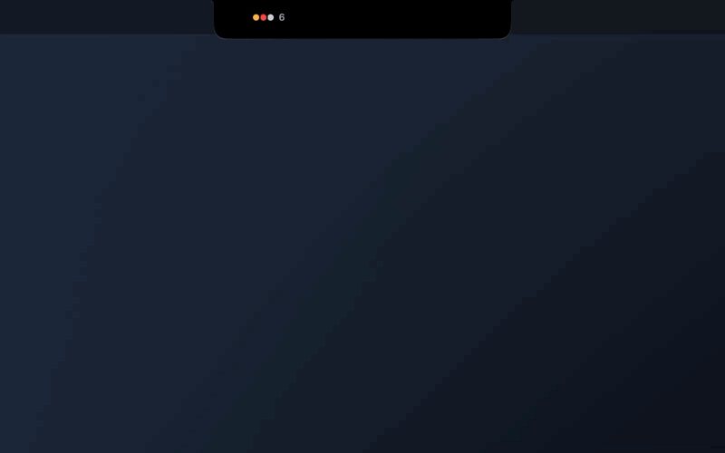
</p>

<p align="center"><a href="docs/media/demo.mp4"><b>▶ Watch the 29-second demo</b></a><br>
<sub>Recorded from the real app (a Debug build) with demo projects: agents, a failing CI run, a Claude Code permission request, the split island and a drop.</sub></p>

<p align="center">
  
  
  
  
  <a href="LICENSE"></a>
  <a href="https://github.com/argahv/notchflow/actions/workflows/verify.yml"></a>
</p>

<p align="center"><b>Developer preview, open source, and looking for Swift, SwiftUI, AppKit, macOS graphics and accessibility contributors.</b><br>
<a href="CONTRIBUTING.md">How to contribute</a> · <a href="https://github.com/argahv/notchflow/issues?q=is%3Aissue+is%3Aopen+label%3A%22good+first+issue%22">Good first issues</a> · <a href="https://github.com/argahv/notchflow/discussions">Discussions</a></p>

---

## It's the notch. Just bigger.

Most notch apps put a card under the camera. NotchFlow doesn't. Every view is the same black shape changing
size: it starts as the hardware notch, stretches when you point at it, and flows outward with continuous
corners and shoulders that melt into the bezel. When there's nothing to say, it tucks itself one point
inside the camera housing and you can't tell it's there.

<p align="center">
  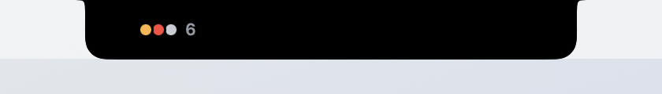
</p>

<p align="center">
  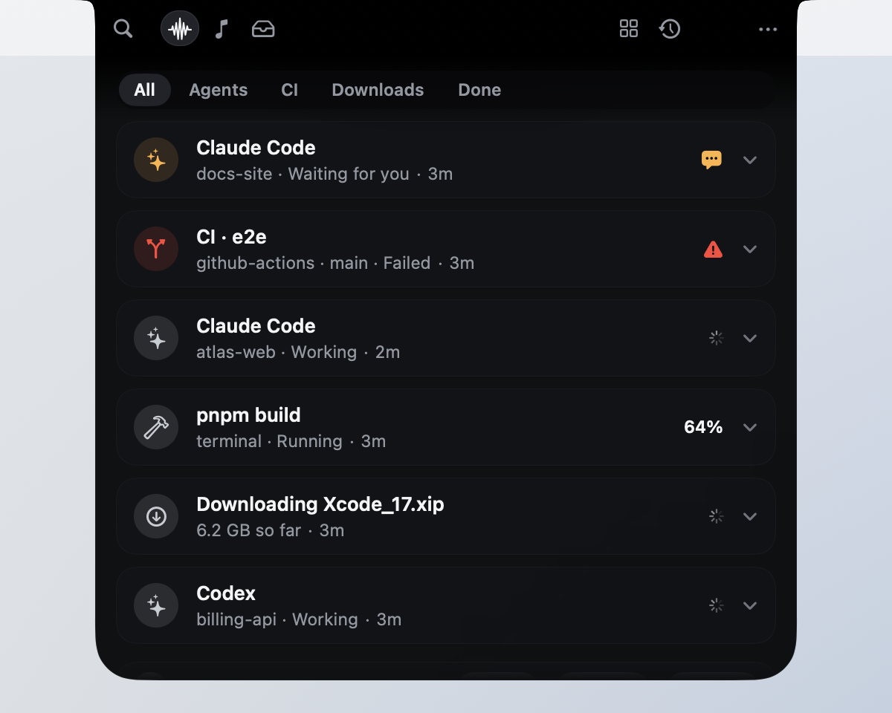
</p>

<p align="center"><sub>Even on a white menu bar there's no seam, no floating card and no drop shadow. It's one shape.</sub></p>

## Drop anything on the notch

Drag a file, an image, a link or some text toward the top of your screen and the notch notices. It
brightens as you get close, names what's coming ("3 images", "Report.pdf") and opens a well to drop into.
Let go, and it takes the drop in and tells you what it kept.

<p align="center">
  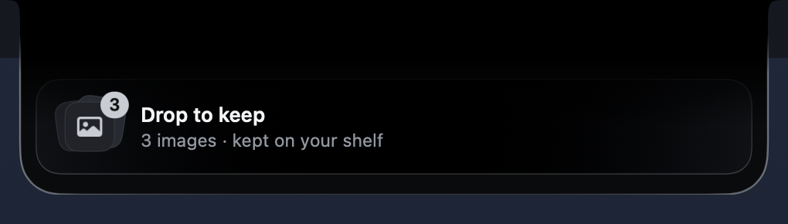
</p>

<p align="center">
  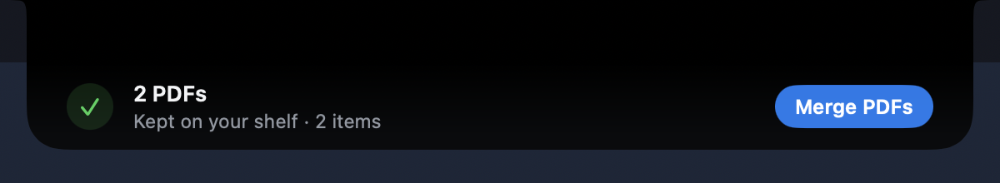
</p>

- **Your files stay where they are.** The shelf keeps a reference and never moves or changes the original.
  Images from a browser and attachments from Mail or Photos have no file of their own, so NotchFlow keeps a
  copy in its own folder and deletes it with the shelf item.
- **Links and text** are kept as they are, formatting included.
- **Drag anything back out** into Finder or another app.
- Quick Look, Open, Copy, Show in Finder and Remove on each item, and Clear with one undo.

<p align="center">
  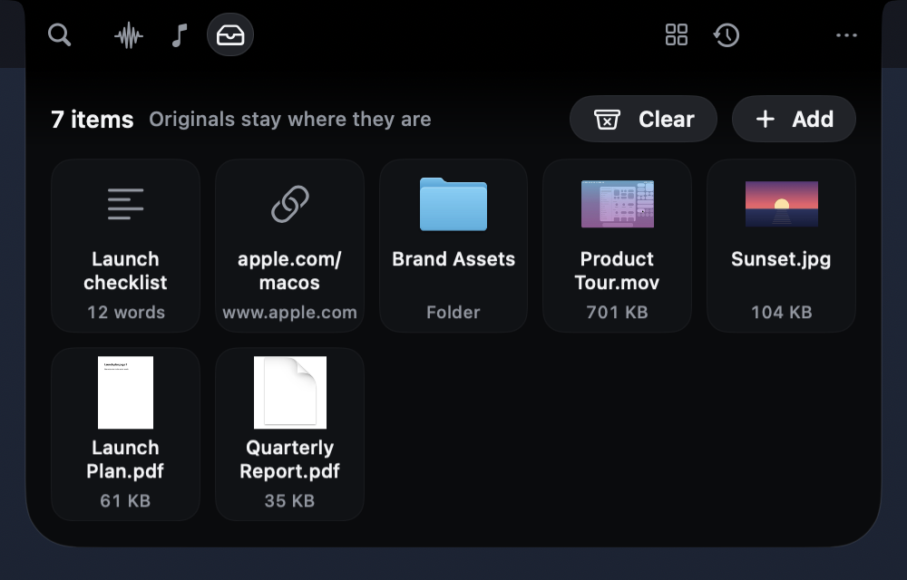
</p>

**Notch Actions.** A drop comes with its next step: drop three PDFs and **Merge PDFs** is right there. Every
action runs on your Mac and says up front what it will do, and anything it creates can be undone. Nothing
you drop is sent to an AI service or anywhere else.

<p align="center">
  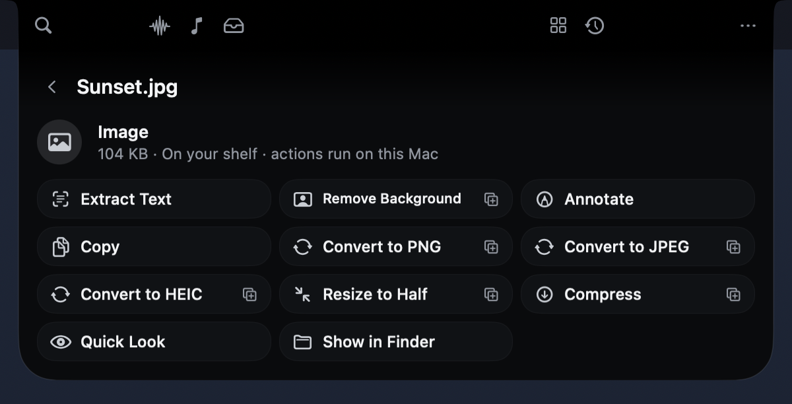
</p>

| You drop | You can |
|---|---|
| Images | Extract Text, Remove Background, convert to PNG, JPEG or HEIC, Resize, Compress, Annotate |
| PDFs | Extract Text, Export as Images, Split Pages, Merge PDFs |
| Text and code | New Note, Clean Up Spacing, Title Case, Count Words, Detect Language |
| Links | Open, Copy, Fetch Title (the one action that uses the internet, and only when you pick it) |
| Audio and video | Details, Convert to M4A, Save a Frame, Compress |

## Approve Claude Code from the notch

Running Claude Code or Codex in a terminal you can't see? NotchFlow follows each session through the
agents' official hooks: which project and branch it's in, what tool it's running, when it's waiting for
you. When it asks for permission, the request appears right at the top of your screen.

<p align="center">
  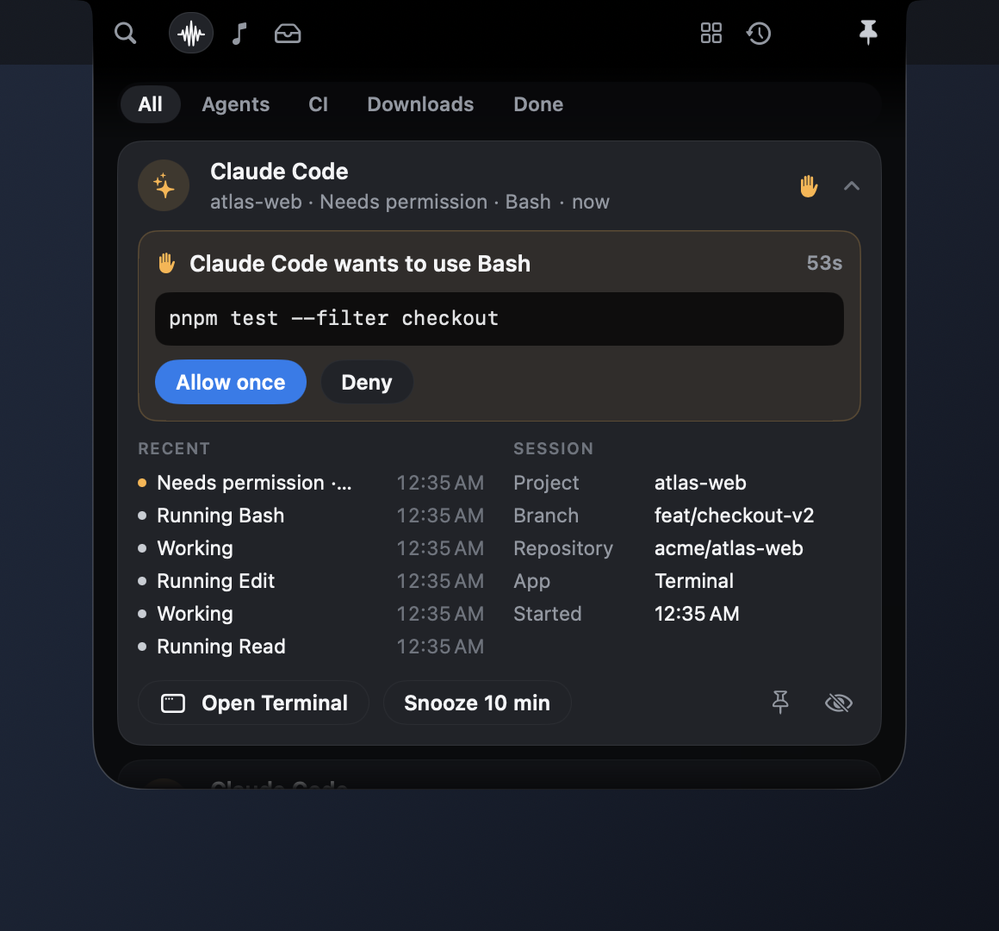
</p>

- **Allow once** (two presses, so it's never an accident) or **Deny**, sent through Claude Code's and
  Codex's documented `PermissionRequest` hook. Nothing is typed into your terminal.
- If you don't answer, NotchFlow steps aside after a short wait and your terminal's own prompt decides.
- **Recent steps** and **session details** at a glance; **Open Terminal** brings the right app forward.
- Your prompts, Claude's replies and tool input never leave the hook. Only the state and tool name do.

**Agent Heartbeat.** Even at rest, a small mark beside the status dots shows what your agents are doing. A
slow flow means working, three steps lighting in turn means tests are running, an amber hand means one is
waiting for you, and a check means a turn finished. It moves for a few seconds after something actually
changes, then holds still. A session that has said nothing for ten minutes shows as quiet, not busy.

<p align="center">
  
</p>

**Mission Complete.** When real work finishes, the notch marks it: a seal settles in, a silver sheen
crosses the lower edge once, and you see the actual result with one next step. Real work means an agent
turn of two minutes or more, a CI run, a build or deploy, a focus session, or a download of 100 MB or more.
Several finishes close together become one ("2 tasks finished"), and it never lands while you're typing.

<p align="center">
  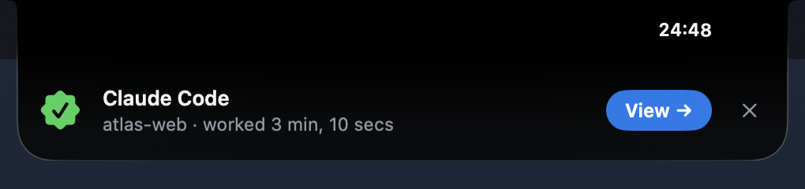
</p>

## Everything that needs you, in one stack

<p align="center">
  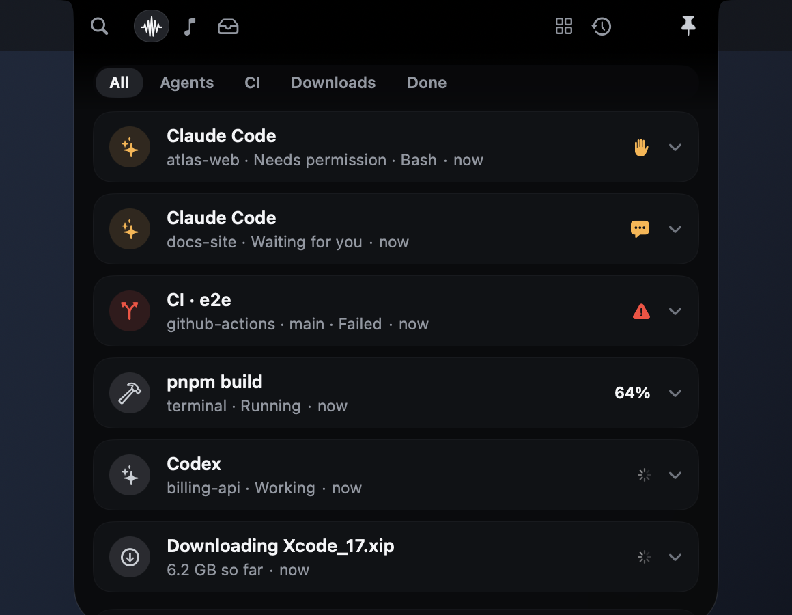
</p>

Agents, GitHub Actions, local builds and downloads share one stack, ranked by what needs you most. Work
that needs input jumps to the top, failures stay for an hour, and finished tasks slip into History on
their own. Filter by **Agents**, **CI**, **Downloads** or **Done**. Percentages appear only when the source
actually reports one. Otherwise you get an honest spinner.

## Notifications that know the next step

<p align="center">
  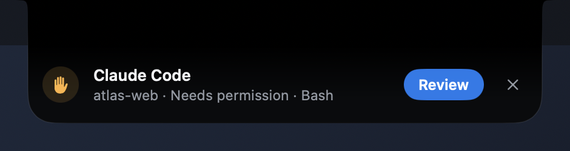
</p>

The notch lights along its lower edge, grows just enough to say what happened, and offers the one thing
you'd do next: **Review** a request, **Join** a call, **Show** a download in Finder, **Open** a failed run.
It never steals keyboard focus, and it never opens over a note you're typing.

## Screenshots, ready to use

Turn on **Settings › Screenshots** and each new screenshot rises out of the notch with **Copy**, **Extract
Text**, **Annotate** and **Save to Shelf**. Text is read on your Mac with Vision. Annotate adds arrows,
boxes, highlights, text, blur and redaction, then saves a new "(annotated)" copy beside the original.
Redaction blacks out the pixels in the saved copy. NotchFlow only picks up files macOS marked as
screenshots, and never moves, renames or deletes them. It's off by default.

<p align="center">
  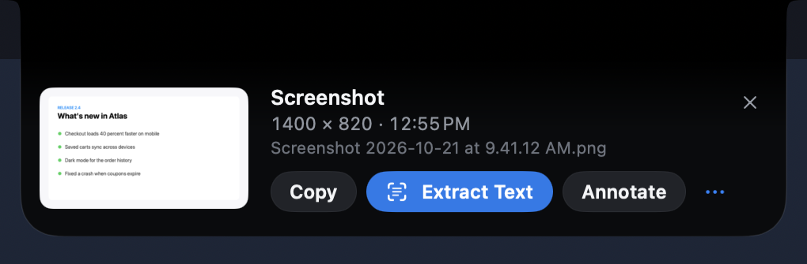
</p>

<p align="center">
  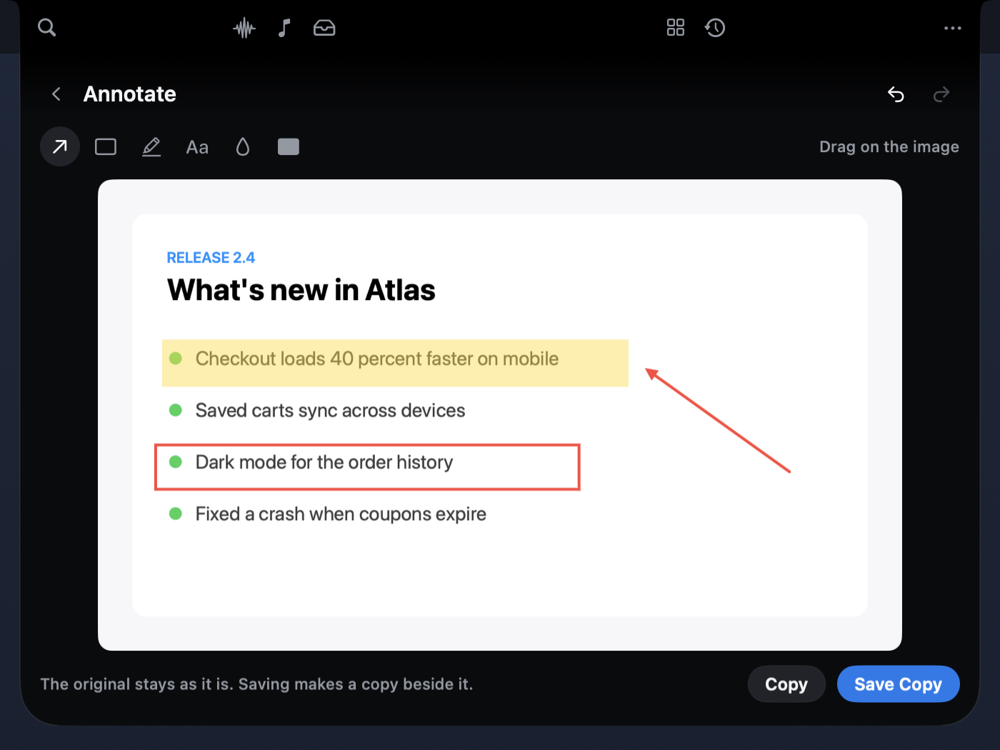
</p>

## A next step for what you copy

*New on the `feature/sixth-sense` branch, not in release 0.2 yet.* Turn on **Settings › Suggestions ›
Suggest from what you copy**, and a copy with an obvious next step grows out of the notch with it, once:

| You copy | The notch offers |
|---|---|
| A link | Copy Clean Link when it carries tracking parameters, Open, Keep on Shelf |
| A color (`#0A84FF`, `rgb(…)`) | A swatch, and the same color as RGB, hex or HSL |
| JSON | Copy Formatted or Copy Minified, every key in its order |
| An address | Open in Maps |
| A date or time | Remind Me (asks for Reminders the first time) |
| An email address or phone number | New Email, Call |
| A path to something on your Mac | Show in Finder, Open |
| A long passage | Keep on Shelf, where Notch Actions can do more, or New Note |
| *A finished download:* an archive | Extract (Archive Utility, the archive is kept), Show in Finder |
| *A finished download:* a PDF, image, video or audio file | Extract Text or its other actions, kept on the shelf by reference |

- **Rules on your Mac decide.** No AI service, no network, and nothing you copied is kept. Password
  managers, apps you exclude and text that looks like a key are skipped before anything else sees them.
- **One at a time, never in the way.** It never opens over a drag, a note you're typing, the open workspace
  or an alert. It waits, and if the moment passes, it goes. A finished build waits behind it; a failure
  doesn't.
- **Why?** shows the reason it was suggested. Copies and additions come with **Undo**.
- **It learns, on this Mac.** Each dismissal makes that kind wait longer, and five in a row turn it off until
  you reset or unmute it. Choose Fewer, Balanced or More, switch kinds off, and set quiet hours. Quiet mode
  and Hide private details pause it.
- **Settings › What NotchFlow observes** says, for every capability, what it reads, why, what leaves your
  Mac, the permission, and how to turn it off and clear it. **Diagnostics › Context Inspector** shows what
  each suggestion was based on, without any content.

**Work modes.** The notch also notices what you're doing: an editor or terminal in front (Developer), a
call in progress (Meeting), a design app (Creative), music playing (Media). The shortcuts on hover follow
(Activity, Clipboard and Shelf while you code; Calendar, Notes and Sound in a call), the right work ranks
first, and suggestions lean that way and stay quiet during calls. A change has to hold for a few seconds,
a line says which mode and why, and one click pins it. Choose Study yourself. **Settings › Work mode**
switches it off or turns off any of its signals; it never opens the notch and reads nothing new.

**Focus sessions that stay focused.** While a focus timer runs, only requests and failures come through.
Finished work, progress and suggestions wait, without a rim or badge. When the session ends, the notch says
"Focus session finished · 25 min · 3 updates waited" with **Review**. This covers NotchFlow's own previews;
macOS doesn't let apps hold other apps' notifications.

How it's built: [Sixth Sense architecture](docs/sixth-sense/01-architecture.md) ·
[plan and roadmap](docs/sixth-sense/02-plan.md) · [verification](docs/sixth-sense/03-verification.md).

## A notch that keeps up

**Living Split Island.** When music or a timer is playing while an agent works, hovering the notch shows
both side by side. Pin the one you care about and it stays. Swipe sideways over a half, or use its chevron,
to switch to the next agent or download. Requests and failures still take the lead, and each side says why
it's there.

<p align="center">
  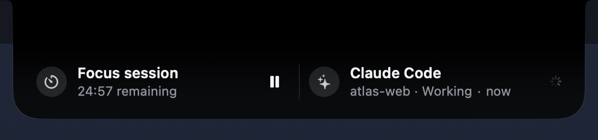
</p>

**Time Travel.** Hold **⌥** and scroll on the notch, or press **⌘Y** in the workspace, to step back
through finished runs, downloads, shelf items, your latest screenshot and, if the clipboard is on, what you
copied. Each moment keeps only the actions that still work: **Show in Finder** disappears once a file is
gone. Nothing new is stored. It's built from what NotchFlow already keeps.

<p align="center">
  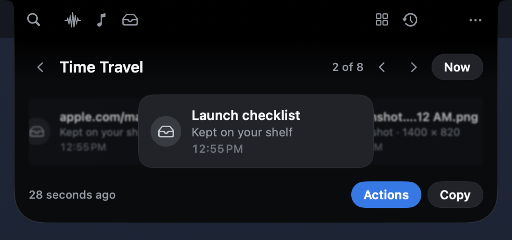
</p>

**Sound Island.** Put on AirPods and the notch says "AirPods Pro connected", with volume, mute, a quick
output switch, and play and next when Music or Spotify is in use. It listens to Core Audio (no permission
needed) and gets out of the way after five seconds.

<p align="center">
  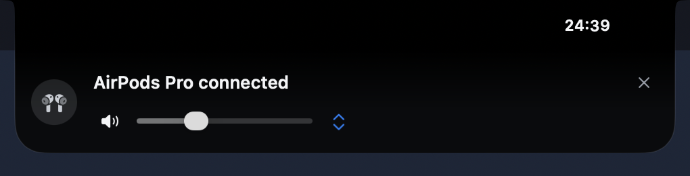
</p>

## Small tools, right where you look

<table>
  <tr>
    <td>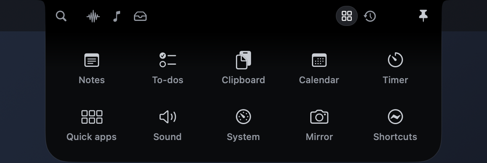</td>
    <td>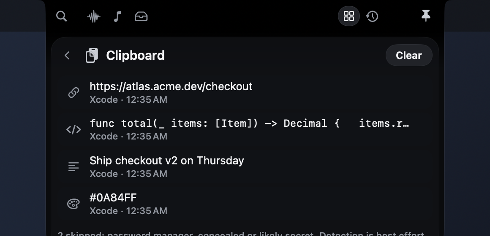</td>
  </tr>
</table>

- **Music**: what's playing in Apple Music or Spotify, with transport controls and a scrubbable timeline.
- **Shelf**: everything you've dropped on the notch (files, images, links and text) with actions for each.
- **Clipboard**: opt-in, kept in memory only, and skips password managers and anything that looks like a key.
- **Meetings**: calls with a Zoom, Meet, Teams, Webex or FaceTime link appear ten minutes early, with **Join**.
- **Download Center**: browser downloads with their real size so far, then the finished file.
- **GitHub Actions**: your repositories' runs, polled efficiently (token optional, kept in Keychain).
- **Focus timer, notes, to-dos, calendar, sound output, system stats, camera mirror, Shortcuts**.
- **⌘K** searches and runs anything, from your keyboard.

It follows what you're doing without getting in the way. With a terminal in front, agents and builds rank
first; with a browser in front, downloads do. It never opens itself.

## Private by design

- No account, no telemetry, no analytics, no server. It makes no network requests unless you add a GitHub
  repository or ask for a link's title.
- Everything that touches your data is **opt-in**: clipboard, copy suggestions, downloads, meetings,
  screenshots, agent approvals, GitHub. Settings lists what each one observes and how to clear it.
- What you drop on the notch stays on your Mac. Actions run locally, and nothing is sent to an AI service.
- macOS permissions are requested only when you turn on the feature that needs them. NotchFlow never needs
  Accessibility or your microphone.
- History stays on your Mac, in owner-only files. Details: [security and privacy](docs/security/integrations.md).

## Get NotchFlow

<p align="center">
  <a href="https://github.com/argahv/notchflow/releases/latest"></a>
</p>

Download the zip from the [latest release](https://github.com/argahv/notchflow/releases/latest), unzip it, and drag
**NotchFlow** to Applications. It's signed with a Developer ID and notarized by Apple, so it opens like any
other app. It needs macOS 14.6 or later and runs natively on Apple silicon and Intel. Each release lists a
SHA-256 checksum.

<details>
<summary>Build it yourself instead</summary>

You need Xcode 16 or later.

```bash
git clone https://github.com/argahv/notchflow.git
```

```bash
cd notchflow && bash Scripts/build.sh
```

```bash
open build/NotchFlow.app
```

That's an unsigned universal build for development. macOS treats every unsigned build as a new app, so it
asks again for folder access (Downloads, Desktop) after each rebuild. To keep permissions between builds,
sign it with any code-signing identity in your keychain (`security find-identity -p codesigning -v` lists
them):

```bash
NOTCHFLOW_SIGN_IDENTITY="Apple Development: Your Name (TEAMID)" bash Scripts/build.sh
```

Releases are made with `Scripts/release.sh`; see [releasing](docs/RELEASING.md).

</details>

**First steps.** Hover the notch, or press **⌃⌥Space** anywhere. Pick a mode in Settings: **Minimal**,
**Dynamic** or **Developer**. To follow Claude Code or Codex, open **Settings › Agents**, press **Copy**, and
merge the snippet into `~/.claude/settings.json` (or `~/.codex/hooks.json`). NotchFlow never edits those
files for you. [More on agents](docs/architecture/agent-integrations.md).

| Shortcut | Does |
|---|---|
| ⌃⌥Space | Open or close, from anywhere |
| ⌘1 … ⌘5 | Activity, Music, Shelf, Tools, History |
| ⌘K | Search and commands |
| ⌘Y | Time Travel, from the workspace |
| ⌥ + scroll on the notch | Time Travel, from the resting notch |
| Esc | Back, then close and return to your app |

Works on Macs without a notch too: it draws one at the top centre of the display you choose.

## From your own scripts

Anything can post to the notch. Wrap a command and see it run, finish or fail:

```bash
python3 Scripts/notchflow.py run --title 'Web tests' -- npm test
```

Or publish your own status:

```bash
python3 Scripts/notchflow.py emit --title 'Deploy ready for review' --phase waiting
```

Events go to an owner-only local inbox; there's no listening port. See the [event contract](docs/INTEGRATIONS.md).

## Status

**Developer preview (0.2).** NotchFlow is built and tested on a MacBook Air with a notch: 181 Swift and 24
Python tests run in CI on every push, alongside Debug and universal Release builds, plus end-to-end hook
checks and frame-by-frame recordings of its transitions. The newest features (the portal, screenshots,
actions, the agent heartbeat, the split island, Time Travel and the sound island) were run on a Debug build
through the same code a drop, a screenshot or an output change goes through. Some things still need a person
at the Mac: real drags from Finder, Safari, Mail and Photos, a real ⇧⌘4 screenshot, a live Claude Code or
Codex session with the hooks installed, AirPods connecting, and the trackpad gestures. See the
[validation report](docs/obsidian-silver/02-validation.md),
[living notch progress](docs/implementation/living-notch-progress.md) and [progress](docs/implementation/progress.md).

The screenshots on this page are the real app. They were captured over a neutral wallpaper and menu bar, so
no personal desktop appears, and they use demo projects.

### Known limitations

- **Tested on one Mac so far.** External displays, Macs without a notch, Spaces, full screen and Stage
  Manager haven't had a full hands-on pass. Reports from other hardware are very welcome.
- **Agent approvals and hooks** are covered by fixture tests, not yet by a long live Claude Code or Codex
  session. You merge the hook snippet yourself; NotchFlow never edits agent config.
- **Ultra glass is experimental.** The Metal "Ultra" surface needs Screen Recording permission, compiles its
  shader at runtime, and hasn't been verified on screen. Balanced (the default) uses system materials.
- **Accessibility is partial.** Labels, VoiceOver actions, Reduce Motion and Reduce Transparency are in;
  a full VoiceOver pass, Increase Contrast and Differentiate Without Color aren't done yet.
- **Memory over long sessions** grew from about 26 to 52 MB footprint in one measurement and hasn't been
  investigated with Instruments yet.
- **GitHub Actions** is polled (with ETags and rate-limit back-off), not pushed by webhooks.

### Roadmap

Near term, roughly in order. Each has or will get an issue:

1. Hardware validation on more Macs and displays, and fixes for what turns up.
2. A full accessibility pass: VoiceOver, keyboard, contrast, colour-independent status.
3. Performance instrumentation (signposts, footprint in the profiler) and the long-session memory question.
4. Smarter agent integration: better test-run detection, more agents through the [event contract](docs/INTEGRATIONS.md).
5. Ultra glass: zero-copy frames, then on-screen verification.
6. Sixth Sense: more context sources and suggestion rules, then workspaces and workflows built on the same
   action catalog. Priorities and platform limits are in the [plan](docs/sixth-sense/02-plan.md).

Not planned for now: accounts, cloud sync, telemetry, or sending anything you drop to an AI service.

## Contributing

NotchFlow is MIT licensed and contributions are welcome, from a one-line accessibility label to a Metal
renderer. **We're looking for Swift, SwiftUI, AppKit, macOS graphics and accessibility contributors.**

- [CONTRIBUTING.md](CONTRIBUTING.md): requirements, build, tests, architecture, conventions and the PR flow.
- [Good first issues](https://github.com/argahv/notchflow/issues?q=is%3Aissue+is%3Aopen+label%3A%22good+first+issue%22)
  and [help wanted](https://github.com/argahv/notchflow/issues?q=is%3Aissue+is%3Aopen+label%3A%22help+wanted%22).
  Each lists the files, acceptance criteria and how to test.
- Questions and ideas: [Discussions](https://github.com/argahv/notchflow/discussions).
- Security: [SECURITY.md](SECURITY.md). Conduct: [Code of Conduct](CODE_OF_CONDUCT.md).

```bash
swift test                          # NotchCore, on macOS
python3 -I Tests/test_bridge.py     # the event CLI and agent hooks, on any OS
```

- `Sources/NotchCore`: the testable core, covering the activity engine, ranking, geometry, GitHub mapping,
  context rules, content rules, and the rules behind the portal, shelf, screenshots, actions, agent pulse,
  split island, Time Travel and sound, plus Sixth Sense: context events, the intent engine, the action
  catalog, surface tiers and the privacy catalog.
- `Sources/NotchFlow`: the app. `Shell` (surface and layout), `Design` (tokens, silhouette, materials,
  motion), `Surfaces` (features), `Features` (providers and services), `Window` (panel, input, geometry),
  `Graphics` (experimental Metal glass).
- `Scripts`: the project generator, the event CLI and agent hooks, and build and notarization scripts.

Design and architecture: [Obsidian & Silver design](docs/obsidian-silver/01-design.md) · [dynamic hover](docs/obsidian-silver/03-dynamic-hover.md) ·
[activity engine](docs/architecture/activity-engine.md) · [agent integrations](docs/architecture/agent-integrations.md) ·
[context engine](docs/architecture/context-engine.md) · [Sixth Sense](docs/sixth-sense/01-architecture.md) ·
[motion](docs/design/motion-system.md) · [acceptance tests](docs/testing/acceptance-tests.md).

## License

[MIT](LICENSE) © 2026 Raghav Kattel. NotchFlow is an original implementation, with no proprietary source,
assets or extracted shaders.
